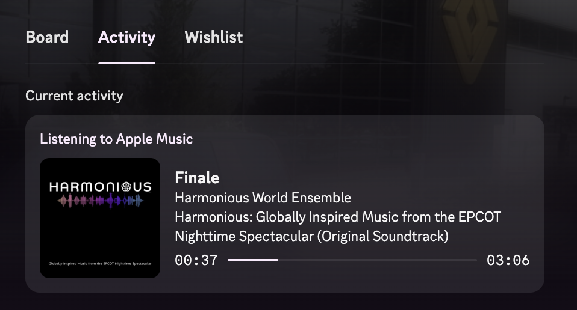

# Apple Music Discord Presence

Show what you're playing in Apple Music on your Discord profile, the same way Spotify does.



- "Listening to" status with song, artist and album
- Album artwork pulled from Apple Music
- Live progress bar that follows skips and seeks
- "Listen on Apple Music" button for your friends
- Clears automatically when you pause
- Runs quietly in the background and reconnects if Discord restarts

No dependencies. It uses the Python 3 that ships with macOS and talks to the Discord desktop app directly.

## Requirements

- macOS with the Music app
- Discord **desktop** app (the browser version can't show Rich Presence)
- Python 3 (run `python3 --version`. If macOS offers to install developer tools, accept.)

## Setup

### 1. Create a Discord application

1. Go to the [Discord Developer Portal](https://discord.com/developers/applications) and click **New Application**.
2. Name it **Apple Music**. That name is what shows in "Listening to Apple Music".
3. Copy the **Application ID** from the General Information page.

Optional: under **Rich Presence → Art Assets**, upload an Apple Music logo with the key `applemusic`. It's used when a song isn't in the Apple Music catalog (local files, for example).

### 2. Install

```bash
git clone https://github.com/RivianTrackr/apple-music-discord.git
cd apple-music-discord
./install.sh
```

Paste your Application ID when asked and pick what your status line should show. Then play a song. The first time, macOS will ask to let python3 control Music. Click **Allow**.

That's it. It starts automatically every time you log in.

### Just want to try it first?

```bash
DISCORD_CLIENT_ID=your_app_id python3 music_discord.py
```

Press Ctrl+C to stop.

## Settings

| Environment variable | What it does |
| --- | --- |
| `DISCORD_CLIENT_ID` | Your Discord Application ID (required) |
| `DISCORD_STATUS_DISPLAY` | What the member list shows after "Listening to". `1` artist (default), `2` song title, `0` Apple Music |

To change settings later, just run `./install.sh` again.

## Troubleshooting

**Nothing shows up on Discord.** Check the log:

```bash
tail -f ~/Library/Logs/apple-music-discord.log
```

- "Discord isn't running" means the desktop app isn't open, or you're using Discord in a browser.
- Make sure **Settings → Activity Privacy → Share my activity** is turned on in Discord.

**Music permission was denied.** Go to **System Settings → Privacy & Security → Automation** and allow python3 (or Terminal) to control Music.

**I can't see the button.** Discord hides Rich Presence buttons from you. Your friends can see them.

## Uninstall

```bash
./uninstall.sh
```

## License

MIT
